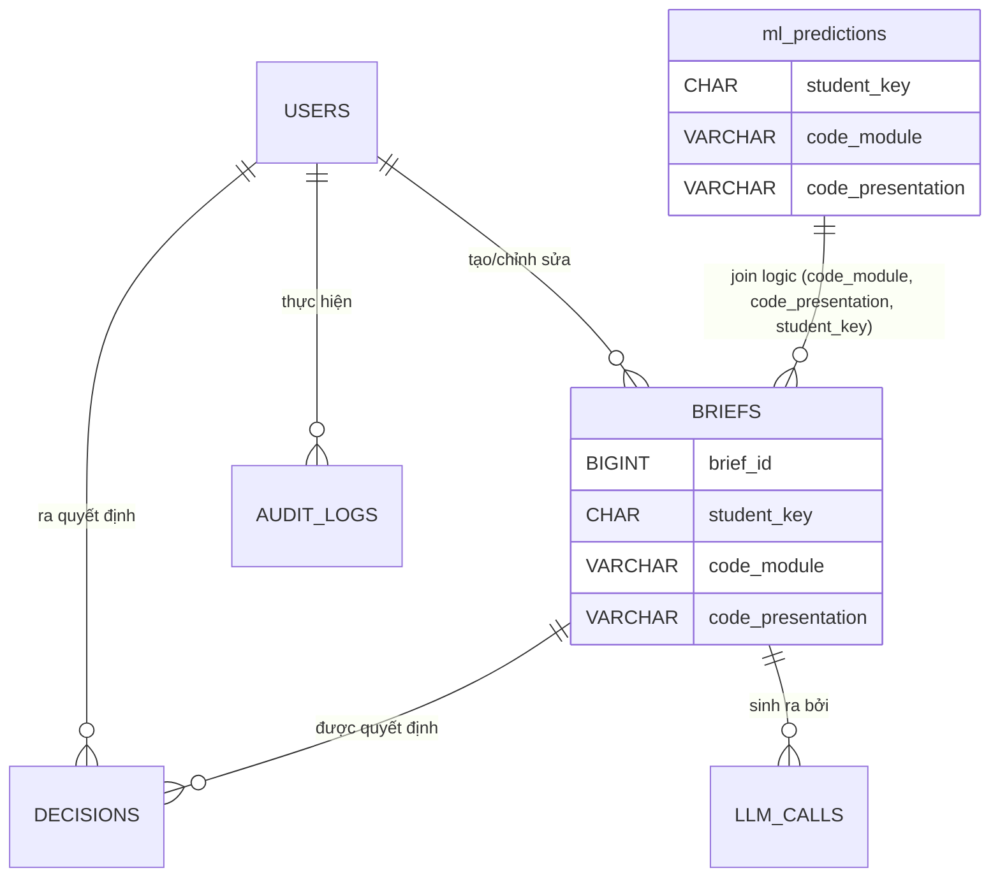

# LearnGuard Backend — DB Contract

> **Phiên bản:** 1.0 — approved (2026-10-30, bản 2: backend là consumer chỉ đọc)
> **Trạng thái:** Đã chốt với phía pipeline. Nguồn chân lý hợp đồng dữ liệu ML: `ml-data/docs/M5_PREDICTION_BATCH.md` §2 và §4.
> **Sở hữu:** Repo `backend` (M7 persistence). Repo `ml-data` (M1–M5) và `frontend` (M9) chỉ **đọc tài liệu này**, không được sửa.

---

## 1. Mục đích và phạm vi

Tài liệu này định nghĩa **hợp đồng database** giữa data pipeline và backend, gồm:

1. Hợp đồng ĐỌC bảng `ml_predictions` — kết quả chấm điểm do pipeline ghi thẳng vào PostgreSQL dùng chung (§6.4).
2. Schema các bảng backend tự sở hữu: `users`, `briefs`, `decisions`, `llm_calls`, `audit_logs` (§6).
3. Công thức `student_key` để backend join dự đoán về sinh viên thật (§9).
4. Chính sách PII/pseudonymization, versioning schema, phân quyền DB.

**Ngoài phạm vi:** logic training/scoring của pipeline (xem `ml-data/docs/`), API REST của backend (xem `system-design.md`), cấu hình runtime.

---

## 2. Luồng dữ liệu (bản 2 — backend chỉ đọc)

```
OULAD CSV (7 bảng thô, ml-data/data/oulad/)
   │  M1 ingestion — dedupe + validate theo ml-data/src/learnguard/data/schema.py
   │  M2 feature snapshot — point-in-time tại cutoff_day, ledger JSON
   │  M3–M4 train/evaluate — model.manifest.json (logistic-model-v1)
   │  M5 scoring
   ▼
ml-data GHI THẲNG vào PostgreSQL dùng chung (upsert bảng ml_predictions,
DSN từ env LEARNGUARD_PG_DSN; all-or-nothing, lỗi DB → lệnh score fail)
   │
   ▼  Backend (M6–M8) chỉ SELECT ml_predictions → REST API → advisor dashboard (M9)
   (users, briefs, decisions, llm_calls, audit_logs do backend tự ghi — §6)
```

- **KHÔNG có import service phía backend.** Quyết định trước đây (backend đọc artifact `prediction-batch.v1` rồi tự ghi DB) đã bị thay thế ngày 2026-10-30.
- File artifact `prediction-batch.v1` vẫn được pipeline xuất song song làm audit trail + xác minh chéo; backend không tiêu thụ nó trong luồng chạy thường.
- Backend **không INSERT/UPDATE/DDL** trên `ml_predictions`. Bảng này do ml-data tạo (ensure_schema) và sở hữu ghi.

---

## 3. Quy ước chung

| Quy ước | Giá trị |
|---|---|
| Hệ QTCSDL | PostgreSQL >= 15 (demo hiện tại: 16.15) |
| ORM / migration | SQLAlchemy 2 (declarative) + Alembic — chỉ cho **bảng backend sở hữu** |
| Tên bảng/cột | `snake_case` |
| Khóa chính | `BIGSERIAL` (`*_id`); `ml_predictions` dùng PK composite theo hợp đồng ml-data |
| Timestamp | `TIMESTAMPTZ`, luôn UTC |
| JSON | `JSONB` cho bảng backend sở hữu; `ml_predictions.top_signals_json` là TEXT theo hợp đồng ml-data (backend tự parse) |
| Số thực | `DOUBLE PRECISION` cho score/uncertainty, `NUMERIC` cho tiền tệ |
| Bất biến | `briefs` và `decisions` là **append-only** — không UPDATE nội dung, sửa = version/event mới |
| Xóa | Không soft-delete; `users.active = false` là vô hiệu hóa, không xóa hàng |
| Kết nối | DSN qua env (DATABASE_URL hoặc LEARNGUARD_PG_DSN) — không hardcode credential |

---

## 4. Hợp đồng dữ liệu ML

Không còn ingest contract phía backend. Hợp đồng đọc bảng `ml_predictions` — bao gồm schema, PK, upsert semantics, 4 status, index, phân quyền — được tham chiếu **nguyên văn** từ:

> **`ml-data/docs/M5_PREDICTION_BATCH.md` §4** (bản 2, 2026-10-30)

Tóm tắt các điểm bắt buộc backend phải tuân thủ (bản quyền là file ml-data):

1. Backend chỉ `SELECT`; quyền user DB của backend = SELECT trên `ml_predictions`.
2. PK `(code_module, code_presentation, student_key)` — mỗi SV 1 dòng mỗi học phần, **luôn là dự đoán mới nhất** (run mới upsert đè run cũ). Không cần JOIN "batch mới nhất".
3. `status` có **4 giá trị**: `scored` / `manual_review` / `insufficient_data` / `no_prediction` — mọi code path phải xử lý đủ 4.
4. `predicted_label` có thể NULL — serialization không được lỗi.
5. Đổi schema `ml_predictions` = breaking change: ml-data thông báo trước, backend đồng bộ.

---

## 5. (đã bỏ)

Mục mapping import 14 cột parquet không còn — backend không import. Công thức `student_key` chuyển về §9.

---

## 6. Schema bảng

### 6.1 `users` — tài khoản advisor/admin *(backend sở hữu)*

| Cột | Kiểu | Ràng buộc |
|---|---|---|
| `user_id` | BIGSERIAL | PK |
| `email` | VARCHAR(255) | NOT NULL, UNIQUE |
| `full_name` | VARCHAR(255) | NOT NULL |
| `role` | VARCHAR(16) | NOT NULL, CHECK ∈ `advisor`, `admin` |
| `password_hash` | VARCHAR(255) | NOT NULL |
| `active` | BOOLEAN | NOT NULL, DEFAULT true |
| `created_at` | TIMESTAMPTZ | NOT NULL, DEFAULT now() |

### 6.2 (đã bỏ)

`model_versions` / `prediction_batches` không còn trong schema backend — metadata model và provenance run do phía pipeline quản lý (`model.manifest.json`, cột `run_id` trong `ml_predictions`).

### 6.3 `ml_predictions` — dự đoán ML *(ml-data sở hữu ghi; backend chỉ SELECT)*

Contract đầy đủ: **`ml-data/docs/M5_PREDICTION_BATCH.md` §4**. Bản chép để tiện tra cứu — nếu lệch nhau, file ml-data thắng:

| Cột | Kiểu | Ghi chú |
|---|---|---|
| `student_key` | CHAR(16) | Pseudonymous key — công thức §9 |
| `code_module` | VARCHAR | PK phần 1 |
| `code_presentation` | VARCHAR | PK phần 2 |
| `split` | VARCHAR | `train` / `validation` / `holdout` |
| `risk_score` | DOUBLE PRECISION | NULL khi không score được |
| `predicted_label` | SMALLINT NULL | NULL khi không gán nhãn được |
| `threshold` | DOUBLE PRECISION | Ngưỡng của model version |
| `uncertainty` | DOUBLE PRECISION | ≥ 0.8 → `manual_review` |
| `status` | VARCHAR | 4 giá trị — §4 điểm 3 |
| `review_reason` | VARCHAR NULL | `insufficient_data` / `high_uncertainty` / `no_prediction` / NULL |
| `model_version` | VARCHAR | Format `{algo}-v1:{hash}:{hash}:{hash}` |
| `snapshot_version` | VARCHAR | Format `snapshot-v1:cutoff{day}:{hash}:{hash}` |
| `cutoff_day` | INTEGER | Ngày cắt point-in-time (hiện 27) |
| `top_signals_json` | TEXT | JSON array tối đa 5 signal `{feature_name, contribution, direction}` — backend parse khi đọc |
| `run_id` | VARCHAR | Run sinh ra dòng này (provenance) |
| `scored_at` | TIMESTAMPTZ | Thời điểm chấm |

- **PK:** `(code_module, code_presentation, student_key)`.
- **Index sẵn có:** `(status)`, `(model_version)`.
- **Backend KHÔNG tạo Alembic migration cho bảng này** — schema do ml-data đảm bảo (ensure_schema).

### 6.4 `briefs` — brief bất biến theo version *(backend sở hữu)*

| Cột | Kiểu | Ràng buộc |
|---|---|---|
| `brief_id` | BIGSERIAL | PK |
| `student_key` | CHAR(16) | NOT NULL — join `ml_predictions` qua (code_module, code_presentation, student_key) |
| `code_module` | VARCHAR | NOT NULL |
| `code_presentation` | VARCHAR | NOT NULL |
| `version` | INTEGER | NOT NULL — bắt đầu 1, tăng dần |
| `content` | JSONB | NOT NULL |
| `citations` | JSONB | NOT NULL, DEFAULT `[]` |
| `status` | VARCHAR(24) | NOT NULL, DEFAULT `awaiting_review`, CHECK ∈ `awaiting_review`, `accepted`, `rejected` |
| `created_by` | BIGINT | FK → `users` (NULL nếu do hệ thống sinh) |
| `created_at` | TIMESTAMPTZ | NOT NULL, DEFAULT now() |

- `UNIQUE (code_module, code_presentation, student_key, version)`.
- **Không UPDATE `content`/`citations`** — chỉnh sửa tạo version mới.

### 6.5 `decisions` — quyết định advisor (first-class event) *(backend sở hữu)*

| Cột | Kiểu | Ràng buộc |
|---|---|---|
| `decision_id` | BIGSERIAL | PK |
| `brief_id` | BIGINT | NOT NULL, FK → `briefs` |
| `user_id` | BIGINT | NOT NULL, FK → `users` |
| `action` | VARCHAR(8) | NOT NULL, CHECK ∈ `accept`, `reject`, `edit` |
| `feedback` | TEXT | NULL |
| `decided_at` | TIMESTAMPTZ | NOT NULL, DEFAULT now() |

### 6.6 `llm_calls` — observability LLM *(backend sở hữu)*

| Cột | Kiểu | Ràng buộc |
|---|---|---|
| `call_id` | BIGSERIAL | PK |
| `brief_id` | BIGINT | NULL, FK → `briefs` |
| `model` | VARCHAR(128) | NOT NULL |
| `prompt_tokens` | INTEGER | NOT NULL, DEFAULT 0 |
| `completion_tokens` | INTEGER | NOT NULL, DEFAULT 0 |
| `cost_usd` | NUMERIC(12, 6) | NULL |
| `latency_ms` | INTEGER | NOT NULL |
| `status` | VARCHAR(24) | NOT NULL, CHECK ∈ `ok`, `validation_failed`, `api_error` |
| `called_at` | TIMESTAMPTZ | NOT NULL, DEFAULT now() |

> Không lưu prompt/response text — chỉ usage/cost/latency/trạng thái (chính sách không log PII).

### 6.7 `audit_logs` — audit truy vết *(backend sở hữu)*

| Cột | Kiểu | Ràng buộc |
|---|---|---|
| `log_id` | BIGSERIAL | PK |
| `user_id` | BIGINT | NULL, FK → `users` |
| `action` | VARCHAR(64) | NOT NULL |
| `entity` | VARCHAR(64) | NOT NULL |
| `entity_id` | VARCHAR(128) | NULL — pseudonymous key khi entity là prediction |
| `payload` | JSONB | NOT NULL, DEFAULT `{}` — **không chứa PII/secrets** |
| `at` | TIMESTAMPTZ | NOT NULL, DEFAULT now() |

- `INDEX (entity, entity_id)`, `INDEX (user_id, at)`.
- Append-only. Mỗi lần truy cập prediction (list/chi tiết) phải ghi 1 dòng audit.

---

## 7. ERD



> Join giữa `ml_predictions` và `briefs` là **logical join** (không FK vật lý — 2 bảng thuộc 2 bên sở hữu khác nhau). ml-data không được thêm FK vào bảng backend.

---

## 8. Enums & state machine

### 8.1 `PREDICTION_STATUS` (nguồn chân lý: `ml-data/src/learnguard/ml/scoring.py`)

| Giá trị | Ý nghĩa |
|---|---|
| `scored` | Đã score bình thường |
| `insufficient_data` | Không đủ dữ liệu điểm/click tại cutoff (`predicted_label` NULL) |
| `manual_review` | `uncertainty >= 0.8` — cần advisor xem thủ công |
| `no_prediction` | Không sinh được prediction |

### 8.2 `BRIEF_STATUS`

`awaiting_review` → (`accepted` | `rejected`); chỉnh sửa sau khi accepted → version mới, quay lại `awaiting_review`.

---

## 9. Công thức `student_key` & pseudonymization

### 9.1 Công thức (nguồn chân lý: `ml-data/docs/M5_PREDICTION_BATCH.md` §2)

Backend giữ danh sách sinh viên (id_student + module/presentation) của riêng mình và tính key bằng đúng công thức để join — **không lưu mapping vào DB**:

```text
student_key = sha256( "learnguard:prediction-batch.v1:{code_module}:{code_presentation}:{id_student}" ).hexdigest()[:16]
```

- Băm chuỗi UTF-8, lấy **16 ký tự hex đầu** (lowercase); `id_student` là số nguyên OULAD, ghép không có khoảng trắng.
- Thay đổi chuỗi tiền tố hoặc độ dài key = **breaking change**, pipeline phải nâng `schema_version` và thông báo backend.

**Test vector bắt buộc pass (kiểm tra chéo với pipeline):**

| code_module | code_presentation | id_student | student_key |
|---|---|---|---|
| AAA | 2013B | 1 | `4c337e13fc7b6871` |
| AAA | 2013J | 11391 | `7bd60aced1ccab8c` |

### 9.2 PII policy

1. DB backend **không chứa** `id_student` hay bất kỳ định danh thực nào — chỉ `student_key` (hash 16 hex).
2. Không lưu prompt/response LLM, không log PII/secrets (DSN, password) vào `audit_logs` hay console.
3. Retention: predictions + audit giữ tối thiểu 1 học kỳ phục vụ audit; chính sách xóa cụ thể chốt khi triển khai M10.

---

## 10. Versioning & tiến hóa schema

1. Schema **bảng backend sở hữu** quản lý bằng Alembic trong repo backend; mỗi thay đổi = 1 migration, không sửa migration đã merge.
2. Schema `ml_predictions` do **ml-data** quản lý (ensure_schema); đổi schema = breaking change, ml-data thông báo trước, backend đồng bộ (§4 điểm 5).
3. Contract này theo semver: thêm cột nullable = **minor**; đổi kiểu/ràng buộc/xóa cột = **major**, phải thông báo các bên tiêu thụ.
4. Bất kỳ code path backend nào ghi vào `ml_predictions` đều là **vi phạm hợp đồng**.

---

## 11. Các điểm đang mở

| # | Vấn đề | Quyết định | Trạng thái |
|---|---|---|---|
| 1 | Bảng students của backend (danh sách id_student để join key) | Backend giữ danh sách riêng; chưa chốt storage (bảng `students` sở hữu backend hay nguồn khác) | TODO — cần chốt khi làm M6 auth/student list |
| 2 | Retention chi tiết | Chốt ở M10 | TODO |
| 3 | Cấu hình DSN | Env `DATABASE_URL` (ưu tiên) hoặc `LEARNGUARD_PG_DSN`; không hardcode | Đã chốt |

---

## 12. Tham chiếu nguồn chân lý

| Nội dung | File |
|---|---|
| Hợp đồng đọc `ml_predictions` + upsert semantics + phân quyền | `ml-data/docs/M5_PREDICTION_BATCH.md` §4 (bản 2) |
| Công thức student_key + test vector | `ml-data/docs/M5_PREDICTION_BATCH.md` §2 |
| 4 status enum, pseudonymous key | `ml-data/src/learnguard/ml/scoring.py` |
| Spec seam M5 → backend | `project/docs/REPOSITORY_LAYOUT.md` |
| ERD thiết kế gốc | `project/docs/system-design.md` §3.7, `project/docs/diagrams/10-m7-db.mmd` |
| DTO backend hiện hành | `backend/src/learnguard_backend/db/models.py` |
