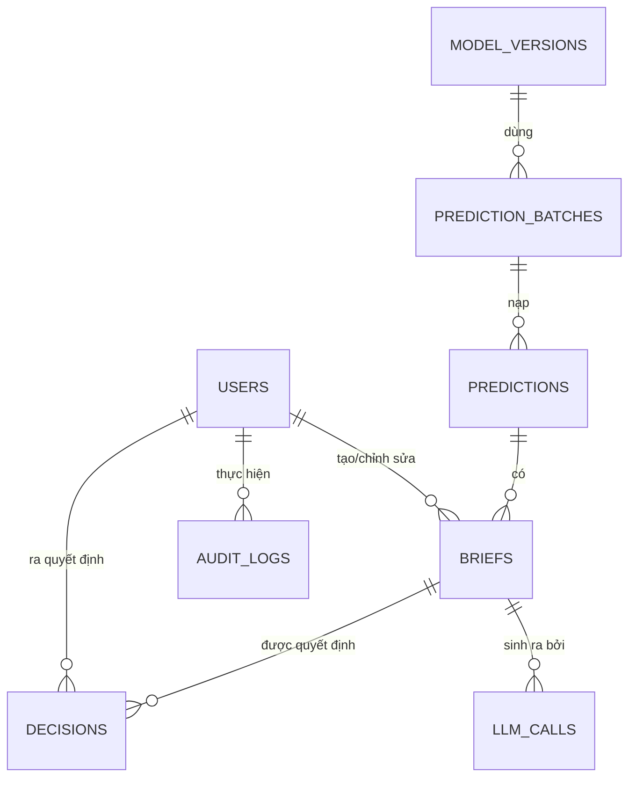

# LearnGuard Backend — DB Contract

> **Phiên bản:** 1.0 — approved (2026-10-30)
> **Trạng thái:** Đã chốt với phía pipeline (`ml-data`, xem `ml-data/docs/M5_PREDICTION_BATCH.md`). Baseline để implement SQLAlchemy + Alembic.
> **Sở hữu:** Repo `backend` (M7 persistence). Repo `ml-data` (M1–M5) và `frontend` (M9) chỉ **đọc tài liệu này**, không được sửa.

---

## 1. Mục đích và phạm vi

Tài liệu này định nghĩa **hợp đồng schema database** giữa data pipeline và backend, gồm:

1. Contract ingest artifact `prediction-batch.v1` do pipeline xuất ra.
2. Schema PostgreSQL đầy đủ: bảng, cột, ràng buộc, index, enum.
3. Mapping trường chuẩn từ `predictions.parquet` (14 cột) vào bảng `predictions`.
4. Chính sách idempotency, PII/pseudonymization, versioning schema.

**Ngoài phạm vi:** logic training/scoring của pipeline, API REST của backend (xem `system-design.md`), cấu hình runtime.

---

## 2. Luồng dữ liệu

```
OULAD CSV (7 bảng thô, ml-data/data/oulad/)
   │  M1 ingestion — dedupe + validate theo ml-data/src/learnguard/data/schema.py
   │  M2 feature snapshot — point-in-time tại cutoff_day, ledger JSON
   │  M3–M4 train/evaluate — model.manifest.json (logistic-model-v1)
   │  M5 scoring
   ▼
Artifact: manifest.json + predictions.parquet + success.json   (schema prediction-batch.v1)
   │
   ▼  [IMPORT — chạy trong backend] verify version + sha256 2 lớp + row_count
   ▼  idempotency theo run_id
PostgreSQL (schema bên dưới)
   │
   ▼  Backend M6–M8 đọc DB → REST API → advisor dashboard (M9)
   (briefs, decisions, llm_calls, audit_logs do backend tự ghi)
```

**Quyết định sở hữu DB (chốt 2026-10-30 — file-based handover):** bước IMPORT chạy trong **backend** (service `PredictionBatchImportService`, `src/learnguard_backend/services/batch_import.py`). Pipeline **không kết nối DB** trong production (chế độ `--pg-dsn` của M5 chỉ dùng cho demo/dev và sẽ bị vô hiệu hóa). Backend đọc artifact từ thư mục giao nhận cấu hình qua env var `LEARNGUARD_BATCH_DIR` (mặc định `../ml-data/artifacts/prediction-batches` so với repo backend). Ranh giới "backend không import code Python ML/data" vẫn được giữ — backend chỉ đọc file theo contract.

---

## 3. Quy ước chung

| Quy ước | Giá trị |
|---|---|
| Hệ QTCSDL | PostgreSQL >= 15 |
| ORM / migration | SQLAlchemy 2 (declarative) + Alembic |
| Tên bảng/cột | `snake_case`, số ít cho bảng (ví dụ `prediction_batches` là ngoại lệ: bảng nhiều dòng theo run — giữ nguyên để nhất quán với `run_id`) |
| Khóa chính | `BIGSERIAL` (`*_id`) trừ `model_versions` dùng khóa tự nhiên |
| Timestamp | `TIMESTAMPTZ`, luôn UTC |
| JSON | `JSONB` |
| Số thực | `DOUBLE PRECISION` cho score/uncertainty (khớp parquet float64), `NUMERIC` cho tiền tệ |
| Bất biến | `briefs` và `decisions` là **append-only** — không UPDATE nội dung, sửa = version/event mới |
| Xóa | Không soft-delete; `users.active = false` là vô hiệu hóa, không xóa hàng |

---

## 4. Ingest contract — `prediction-batch.v1`

### 4.1 Artifact (do pipeline xuất)

| File | Nội dung |
|---|---|
| `manifest.json` | Metadata batch (bảng 4.2) |
| `predictions.parquet` | Payload — 14 cột (bảng 5) |
| `success.json` | `{schema_version, run_id, manifest_sha256, predictions_sha256}` |

### 4.2 Manifest v1 — trường bắt buộc

| Trường | Kiểu | Ghi chú |
|---|---|---|
| `schema_version` | str | Hằng `prediction-batch.v1`. Giá trị khác → **từ chối import** |
| `run_id` | str | Định danh lần chạy, dùng cho idempotency |
| `cutoff_day` | int | Ngày cắt dữ liệu point-in-time (hiện tại `27`) |
| `snapshot_version` | str | Format `snapshot-v1:cutoff{day}:{source_hash8}:{feature_list_hash8}` |
| `model_version` | str | Format `{algo}-v1:{hash8}:{hash8}:{hash8}` |
| `created_at` | str ISO-8601 UTC | Thời điểm batch xuất |
| `row_count` | int | Số dòng parquet — phải khớp thực tế |
| `predictions_path` | str | Tên file payload (không chứa đường dẫn) |
| `predictions_sha256` | str 64 hex | Checksum của `predictions.parquet` |

### 4.3 Trình tự verify bắt buộc (backend import)

1. Đọc `manifest.json` → kiểm tra `schema_version` ∈ các version backend hỗ trợ.
2. Tính sha256 của `predictions.parquet` → so khớp `predictions_sha256` trong manifest.
3. Tính sha256 của `manifest.json` → so khớp `manifest_sha256` trong `success.json`.
4. Đếm dòng parquet → so khớp `row_count`.
5. Kiểm tra idempotency: `run_id` đã tồn tại trong `prediction_batches` → **bỏ qua import**, trả về report của lần import trước (không lỗi).
6. Normalize từng dòng (xem bảng 5) rồi insert trong **một transaction** cùng bản ghi `prediction_batches`.
7. Bất kỳ bước nào fail → transaction rollback, batch đánh dấu `status = failed`, không ghi dữ liệu cục bộ.

> **Lưu xác thực 2 lớp:** checksum manifest nằm trong `success.json` do pipeline ghi — backend không được bỏ qua bước 3.

---

## 5. Mapping `predictions.parquet` (14 cột) → bảng `predictions`

| # | Cột parquet | Kiểu nguồn | Cột DB | Xử lý khi import |
|---|---|---|---|---|
| 1 | `student_key` | str (16 hex) | `student_key CHAR(16)` | Giữ nguyên — pseudonymous key, **không có `id_student`** |
| 2 | `code_module` | str | `code_module VARCHAR(4)` | Giữ nguyên |
| 3 | `code_presentation` | str | `code_presentation VARCHAR(5)` | Giữ nguyên |
| 4 | `split` | str | `split VARCHAR(12)` | Giữ nguyên (`train`/`validation`/`holdout`) |
| 5 | `risk_score` | float64 | `risk_score DOUBLE PRECISION` | Giữ nguyên, full precision |
| 6 | `predicted_label` | Int64 nullable | `predicted_label SMALLINT NULL` | NULL khi `insufficient_data` |
| 7 | `threshold` | float64 | `threshold DOUBLE PRECISION` | Giữ nguyên — cần để tái hiện `predicted_label = risk_score >= threshold` |
| 8 | `uncertainty` | float64 nullable | `uncertainty DOUBLE PRECISION` | `= 1 - abs(2*risk_score - 1)`; ≥ 0.8 → `manual_review` |
| 9 | `status` | str | `status VARCHAR` | Thuộc enum PREDICTION_STATUS (mục 8.1) |
| 10 | `review_reason` | str nullable | `review_reason VARCHAR NULL` | `insufficient_data` / `high_uncertainty` / `no_prediction` / NULL |
| 11 | `model_version` | str | `model_version VARCHAR` | FK logic → `model_versions` |
| 12 | `snapshot_version` | str | `snapshot_version VARCHAR` | Không FK — version ngữ nghĩa, không phải khóa |
| 13 | `cutoff_day` | int64 | `cutoff_day SMALLINT` | Phải khớp `prediction_batches.cutoff_day` |
| 14 | `top_signals_json` | str (JSON) | `top_signals JSONB` | **Parse + validate**: mảng tối đa 5 phần tử `{feature_name: str, contribution: float, direction: "increases_risk"\|"decreases_risk"}`. Lỗi parse → batch `failed` |

> **Điểm mấu chốt:** batch không cung cấp `id_student` hay demographics. Backend lưu đúng `student_key` — mọi truy vấn hiển thị cho advisor chỉ dùng metadata an toàn từ chính predictions.

### 5.1 Công thức `student_key` (nguồn chân lý: `ml-data/docs/M5_PREDICTION_BATCH.md` §2)

Backend tham chiếu công thức này khi cần sinh key từ danh sách sinh viên của mình để join — **không cần bảng mapping**:

```text
student_key = sha256( "learnguard:prediction-batch.v1:{code_module}:{code_presentation}:{id_student}" ).hexdigest()[:16]
```

- Băm chuỗi UTF-8, lấy **16 ký tự hex đầu** (lowercase); `id_student` là số nguyên OULAD, ghép không có khoảng trắng.
- Thay đổi chuỗi tiền tố hoặc độ dài key = **breaking change**, pipeline phải nâng `schema_version` và thông báo backend.

**Test vector bắt buộc pass (kiểm tra chéo với pipeline):**

| code_module | code_presentation | id_student | student_key |
|---|---|---|---|
| AAA | 2013B | 1 | `4c337e13fc7b6871` |
| AAA | 2013J | 11391 | `7bd60aced1ccab8c` |

---

## 6. Schema bảng

### 6.1 `users` — tài khoản advisor/admin

| Cột | Kiểu | Ràng buộc |
|---|---|---|
| `user_id` | BIGSERIAL | PK |
| `email` | VARCHAR(255) | NOT NULL, UNIQUE (lowercase) |
| `full_name` | VARCHAR(255) | NOT NULL |
| `role` | VARCHAR(16) | NOT NULL, CHECK ∈ `advisor`, `admin` |
| `password_hash` | VARCHAR(255) | NOT NULL |
| `active` | BOOLEAN | NOT NULL, DEFAULT true |
| `created_at` | TIMESTAMPTZ | NOT NULL, DEFAULT now() |

### 6.2 `model_versions` — registry model

| Cột | Kiểu | Ràng buộc |
|---|---|---|
| `model_version` | VARCHAR(128) | **PK** (khóa tự nhiên, khớp FK logic từ batch) |
| `algorithm` | VARCHAR(64) | NOT NULL (hiện `sklearn.LogisticRegression`) |
| `config` | JSONB | NOT NULL, DEFAULT `{}` — hyperparameters |
| `feature_list_hash` | VARCHAR(64) | NOT NULL |
| `metrics` | JSONB | NOT NULL, DEFAULT `{}` |
| `threshold` | DOUBLE PRECISION | NOT NULL |
| `registered_at` | TIMESTAMPTZ | NOT NULL, DEFAULT now() |

> **Cách điền (Gap 1 — ĐÃ CHỐT 2026-10-30):** khi import batch, backend tìm `model.manifest.json` (schema `logistic-model-v1`) theo thứ tự: (1) trong thư mục batch, (2) trong thư mục cấu hình qua env var `LEARNGUARD_MODEL_MANIFEST_DIR` — quét đệ quy, chọn file có `model_semantic_version` khớp `manifest.model_version` của batch. Điền `algorithm` từ `model_type`, `config` từ `estimator_parameters`, `feature_list_hash` từ `model_contract_hash`, `metrics` từ các trường train/eval có sẵn. Nếu không tìm thấy file khớp, tạo bản ghi rút gọn chỉ với `model_version` + `threshold` lấy từ prediction rows, `metrics = {}`.

### 6.3 `prediction_batches` — provenance & idempotency import

| Cột | Kiểu | Ràng buộc |
|---|---|---|
| `batch_id` | BIGSERIAL | PK |
| `run_id` | VARCHAR(128) | NOT NULL, **UNIQUE** |
| `schema_version` | VARCHAR(32) | NOT NULL |
| `model_version` | VARCHAR(128) | NOT NULL, FK → `model_versions` |
| `snapshot_version` | VARCHAR(128) | NOT NULL |
| `cutoff_day` | SMALLINT | NOT NULL |
| `row_count` | INTEGER | NOT NULL — từ manifest |
| `inserted_rows` | INTEGER | NOT NULL, DEFAULT 0 |
| `skipped_rows` | INTEGER | NOT NULL, DEFAULT 0 |
| `predictions_sha256` | CHAR(64) | NOT NULL |
| `manifest_sha256` | CHAR(64) | NOT NULL |
| `manifest` | JSONB | NOT NULL — toàn bộ manifest gốc, để audit |
| `status` | VARCHAR(16) | NOT NULL, CHECK ∈ `importing`, `completed`, `failed` |
| `imported_at` | TIMESTAMPTZ | NOT NULL, DEFAULT now() |

### 6.4 `predictions` — kết quả scoring do batch nạp

| Cột | Kiểu | Ràng buộc |
|---|---|---|
| `prediction_id` | BIGSERIAL | PK |
| `batch_id` | BIGINT | NOT NULL, FK → `prediction_batches` |
| `student_key` | CHAR(16) | NOT NULL |
| `code_module` | VARCHAR(4) | NOT NULL |
| `code_presentation` | VARCHAR(5) | NOT NULL |
| `split` | VARCHAR(12) | NOT NULL |
| `risk_score` | DOUBLE PRECISION | NULL khi không score được |
| `predicted_label` | SMALLINT | NULL khi `insufficient_data` |
| `threshold` | DOUBLE PRECISION | NULL |
| `uncertainty` | DOUBLE PRECISION | NULL |
| `status` | VARCHAR(24) | NOT NULL, CHECK ∈ PREDICTION_STATUS (8.1) |
| `review_reason` | VARCHAR(32) | NULL |
| `model_version` | VARCHAR(128) | NOT NULL |
| `snapshot_version` | VARCHAR(128) | NOT NULL |
| `cutoff_day` | SMALLINT | NOT NULL |
| `top_signals` | JSONB | NOT NULL, DEFAULT `[]` |
| `scored_at` | TIMESTAMPTZ | NOT NULL — từ `manifest.created_at` |

**Ràng buộc & index:**

- `UNIQUE (batch_id, student_key)` — 1 sinh viên 1 lần mỗi batch.
- `INDEX idx_predictions_queue ON (status, risk_score DESC)` — review queue.
- `INDEX idx_predictions_module ON (code_module, code_presentation)`.

### 6.5 `briefs` — brief bất biến theo version

| Cột | Kiểu | Ràng buộc |
|---|---|---|
| `brief_id` | BIGSERIAL | PK |
| `prediction_id` | BIGINT | NOT NULL, FK → `predictions` |
| `version` | INTEGER | NOT NULL — bắt đầu 1, tăng dần |
| `content` | JSONB | NOT NULL |
| `citations` | JSONB | NOT NULL, DEFAULT `[]` |
| `status` | VARCHAR(24) | NOT NULL, DEFAULT `awaiting_review`, CHECK ∈ BRIEF_STATUS (8.2) |
| `created_by` | BIGINT | FK → `users` (NULL nếu do hệ thống sinh) |
| `created_at` | TIMESTAMPTZ | NOT NULL, DEFAULT now() |

- `UNIQUE (prediction_id, version)`.
- **Không UPDATE `content`/`citations`** — chỉnh sửa tạo version mới.

### 6.6 `decisions` — quyết định advisor (first-class event)

| Cột | Kiểu | Ràng buộc |
|---|---|---|
| `decision_id` | BIGSERIAL | PK |
| `brief_id` | BIGINT | NOT NULL, FK → `briefs` |
| `user_id` | BIGINT | NOT NULL, FK → `users` |
| `action` | VARCHAR(8) | NOT NULL, CHECK ∈ `accept`, `reject`, `edit` |
| `feedback` | TEXT | NULL |
| `decided_at` | TIMESTAMPTZ | NOT NULL, DEFAULT now() |

### 6.7 `llm_calls` — observability LLM

| Cột | Kiểu | Ràng buộc |
|---|---|---|
| `call_id` | BIGSERIAL | PK |
| `brief_id` | BIGINT | NULL, FK → `briefs` |
| `model` | VARCHAR(128) | NOT NULL |
| `prompt_tokens` | INTEGER | NOT NULL, DEFAULT 0 |
| `completion_tokens` | INTEGER | NOT NULL, DEFAULT 0 |
| `cost_usd` | NUMERIC(12, 6) | NULL |
| `latency_ms` | INTEGER | NOT NULL |
| `status` | VARCHAR(24) | NOT NULL, CHECK ∈ `ok`, `validation_failed`, `api_error` |
| `called_at` | TIMESTAMPTZ | NOT NULL, DEFAULT now() |

> Không lưu prompt/response text — chỉ usage/cost/latency/trạng thái (chính sách không log PII).

### 6.8 `audit_logs` — audit truy vết

| Cột | Kiểu | Ràng buộc |
|---|---|---|
| `log_id` | BIGSERIAL | PK |
| `user_id` | BIGINT | NULL, FK → `users` |
| `action` | VARCHAR(64) | NOT NULL |
| `entity` | VARCHAR(64) | NOT NULL |
| `entity_id` | BIGINT | NULL |
| `payload` | JSONB | NOT NULL, DEFAULT `{}` — **không chứa PII/secrets** |
| `at` | TIMESTAMPTZ | NOT NULL, DEFAULT now() |

- `INDEX idx_audit_entity ON (entity, entity_id)`, `INDEX idx_audit_user ON (user_id, at)`.
- Append-only.

---

## 7. ERD



---

## 8. Enums & state machine

### 8.1 `PREDICTION_STATUS` (khớp `PredictionStatus` trong `ml-data/src/learnguard/ml/scoring.py` — nguồn chân lý)

| Giá trị | Ý nghĩa |
|---|---|
| `scored` | Đã score bình thường |
| `insufficient_data` | Không đủ dữ liệu điểm/click tại cutoff (`predicted_label` NULL) |
| `manual_review` | `uncertainty >= 0.8` — cần advisor xem thủ công |
| `no_prediction` | Không sinh được prediction |

### 8.2 `BRIEF_STATUS`

`awaiting_review` → (`accepted` | `rejected`); chỉnh sửa sau khi accepted → version mới, quay lại `awaiting_review`.

### 8.3 `BATCH_STATUS` (import)

`importing` → (`completed` | `failed`).

---

## 9. Chính sách PII & pseudonymization

1. DB backend **không chứa** `id_student` hay bất kỳ định danh thực nào — chỉ `student_key` (hash 16 hex do pipeline sinh).
2. Không lưu prompt/response LLM, không log PII/secrets vào `audit_logs`.
3. Retention: predictions + batches giữ tối thiểu 1 học kỳ phục vụ audit; chính sách xóa cụ thể chốt khi triển khai M10 (hiện TODO ở seam spec).

---

## 10. Versioning & tiến hóa schema

1. Schema quản lý bằng **Alembic** trong repo backend; mỗi thay đổi = 1 migration, không sửa migration đã merge.
2. Contract này theo semver: thêm cột nullable = **minor**; đổi kiểu/ràng buộc/xóa cột = **major**, bắt buộc báo cáo trước với phía pipeline và frontend.
3. Backend chỉ chấp nhận `schema_version` đã liệt kê trong `SUPPORTED_SCHEMA_VERSIONS`; pipeline nâng version → backend phải thêm hỗ trợ rồi mới deploy.
4. `predictions.parquet` thêm cột mới = không phá vỡ contract (backend bỏ qua cột lạ); **bớt/đổi tên cột** = breaking change.

---

## 11. Các điểm đang mở (chốt trước khi implement)

| # | Vấn đề | Quyết định | Trạng thái |
|---|---|---|---|
| 1 | Điền metadata `model_versions` | Đọc `model.manifest.json` (batch dir → `LEARNGUARD_MODEL_MANIFEST_DIR`), thiếu thì bản ghi rút gọn — xem §6.2 | **Đã chốt 2026-10-30** |
| 2 | Vị trí artifact pipeline giao cho backend | Env var `LEARNGUARD_BATCH_DIR`, mặc định `../ml-data/artifacts/prediction-batches` — xem §2 | **Đã chốt 2026-10-30** |
| 3 | Retention chi tiết | Chốt ở M10 | TODO |
| 4 | Bảng `students` + mapping `student_key ↔ id_student` | **Không tạo** — key sinh được bằng công thức §5.1 khi cần join; giữ pseudonymization | Đã chốt |

---

## 12. Tham chiếu nguồn chân lý

| Nội dung | File |
|---|---|
| Manifest + validation pipeline | `ml-data/src/learnguard/ml/contracts.py` |
| 14 cột prediction, status enum, pseudonymous key | `ml-data/src/learnguard/ml/scoring.py` |
| Schema OULAD nguồn (7 bảng) | `ml-data/src/learnguard/data/schema.py` |
| Spec seam M5 → backend | `project/docs/REPOSITORY_LAYOUT.md` |
| ERD thiết kế gốc | `project/docs/system-design.md` §3.7, `project/docs/diagrams/10-m7-db.mmd` |
| DTO backend hiện hành | `backend/src/learnguard_backend/db/models.py` |
| Skeleton import | `backend/src/learnguard_backend/services/batch_import.py` |
